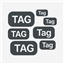
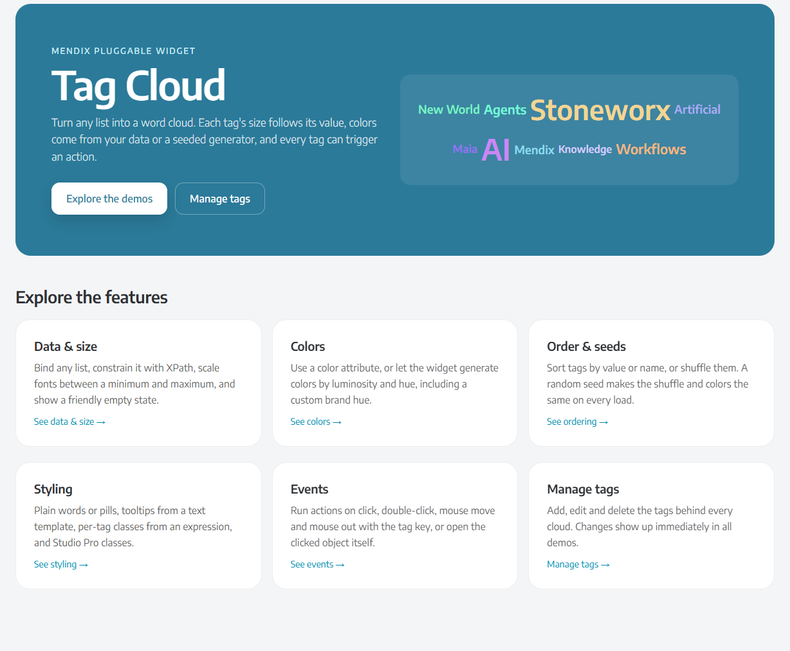
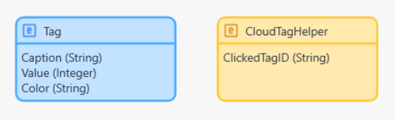
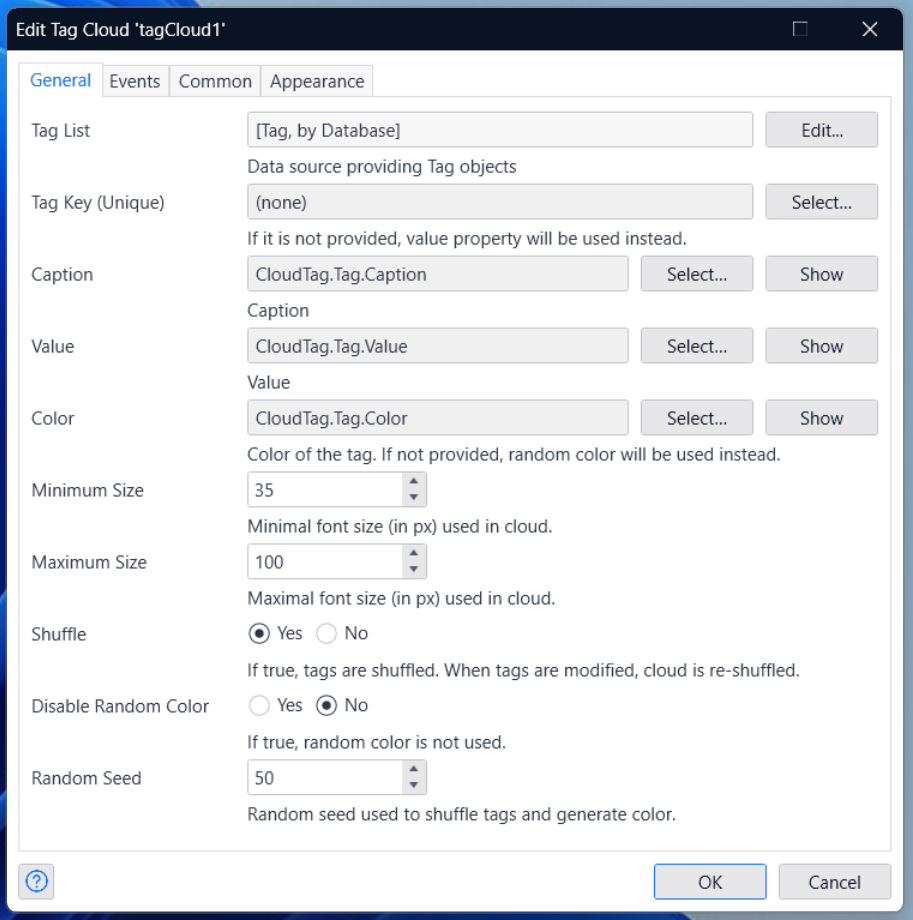
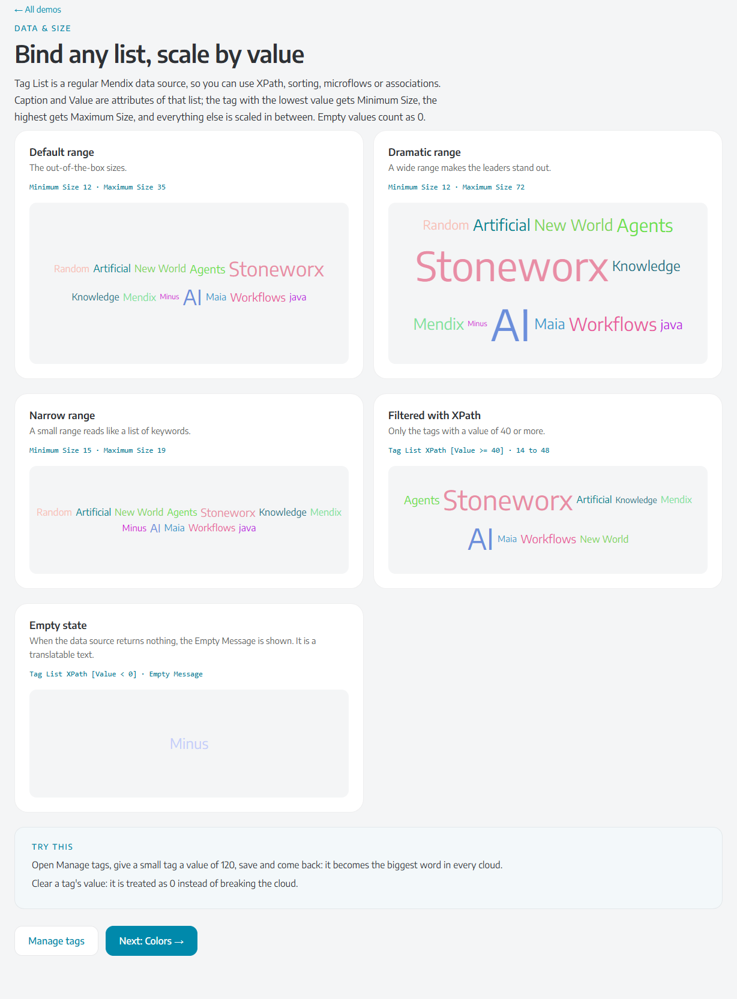
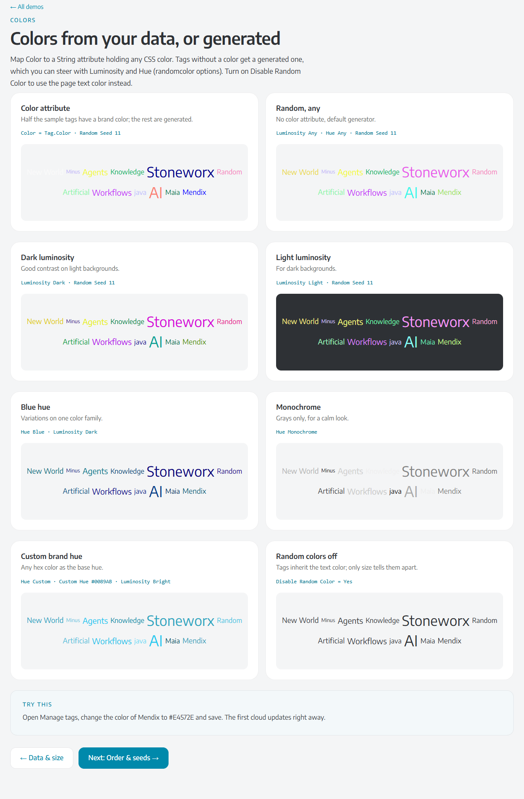
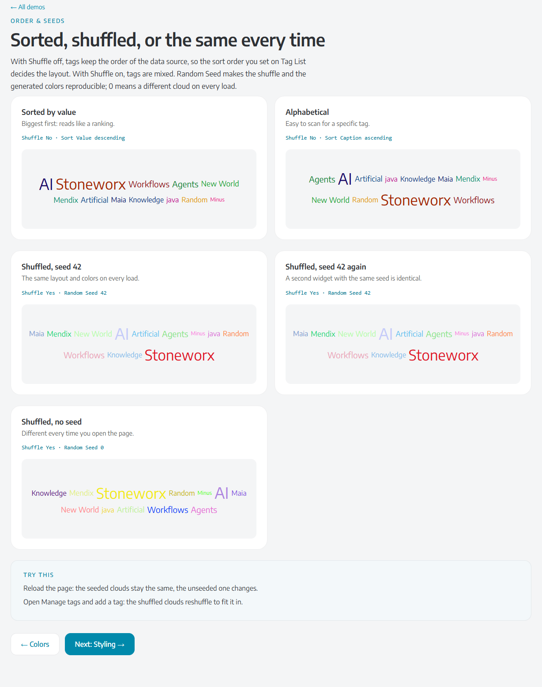
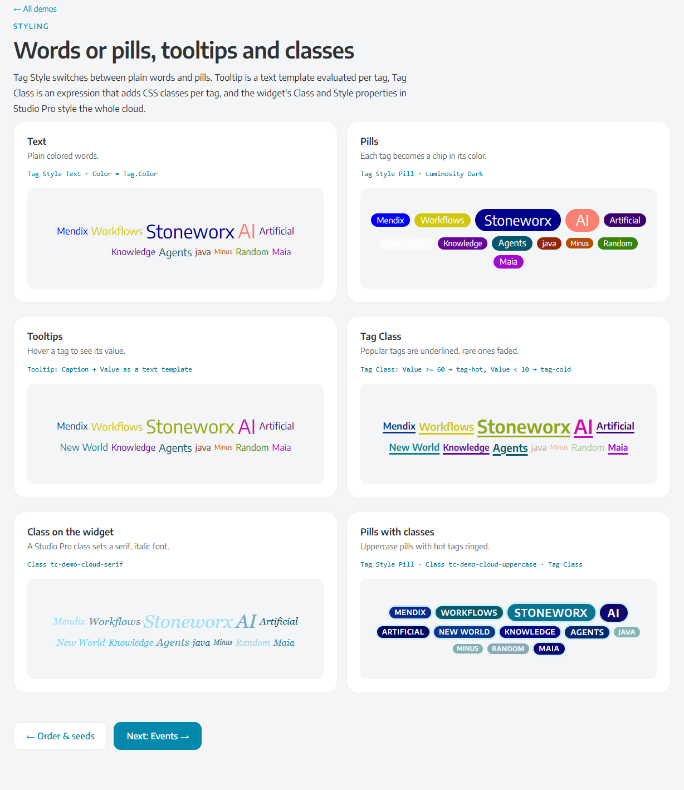
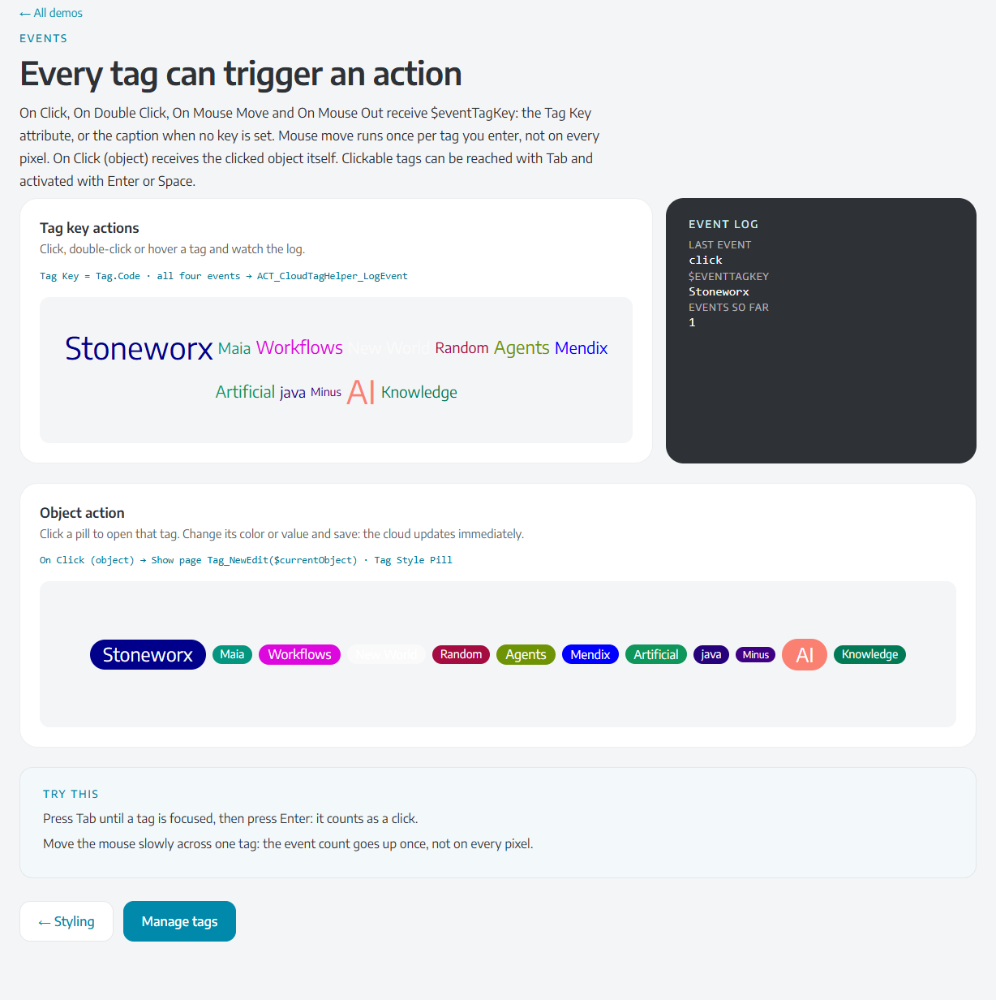

# Tag Cloud Mendix Pluggable Widget



A tag/word cloud for Mendix, based on [react-tagcloud](https://www.npmjs.com/package/react-tagcloud). Each tag's font
size follows its value, colors come from your data or a seeded generator, and tags can run actions.



## Requirements

-   Mendix 11 or newer (the widget is built with Pluggable Widgets Tools 11 and React 19).
-   Web only.

## How to use

1. Create an entity for the tags with a caption (String or Enum) and a value (Integer, Long or Decimal). Optionally add
   a color (String, any CSS color) and a unique key.

    

2. Drag the Tag Cloud widget onto a page and set Tag List to a data source of that entity, then pick the Caption and
   Value attributes. The widget doesn't need a surrounding data view.

    

## Properties

### General

| Property             | Description                                                                                                                     |
| -------------------- | ------------------------------------------------------------------------------------------------------------------------------- |
| Tag List             | Any list data source (database with XPath, microflow, association, ...). Its sort order is the cloud's order when Shuffle is off. |
| Tag Key (Unique)     | Optional String, Integer, Long, AutoNumber or Enum attribute passed to actions as `$eventTagKey`. Defaults to the caption's value (for an Enum, the enumeration key, not the translated caption). |
| Caption              | Text of the tag (String or Enum).                                                                                               |
| Value                | Weight of the tag. Empty values count as 0.                                                                                     |
| Color                | Optional CSS color per tag. Tags without one get a generated color.                                                             |
| Minimum/Maximum Size | Font size in px of the lowest and highest value; the rest is scaled in between.                                                |
| Shuffle              | Mix the tags. Off keeps the data source order.                                                                                  |
| Random Seed          | Makes shuffle and generated colors the same on every load. 0 means a different result each time.                               |

### Appearance

| Property             | Description                                                                                                  |
| -------------------- | ------------------------------------------------------------------------------------------------------------ |
| Tag Style            | Text (colored words) or Pill (chips with the tag color as background and white text).                       |
| Tooltip              | Text template shown on hover, for example `{1}: {2} mentions`.                                               |
| Tag Class            | Expression returning extra CSS classes per tag, for example `if $currentObject/Value > 100 then 'tag-hot' else ''`. |
| Disable Random Color | Tags without a color use the page text color.                                                                |
| Luminosity, Hue      | Steer the generated colors (bright, light, dark; red, blue, monochrome, ... or a custom hex hue). For pills use Dark. |
| Empty Message        | Translatable text shown when the data source returns no tags.                                               |

The widget's Class and Style properties apply to the whole cloud. Tags have the class `tag-cloud-tag` (and
`tag-cloud-tag--pill` for pills); the cloud has `widget-tag-cloud`.

<details>
<summary>Screenshots: data and size, colors, order and seeds, styling</summary>

**Data & size**: size ranges, an XPath-filtered list and the empty message.



**Colors**: color attribute, luminosity, hue, custom hue and random colors off.



**Order & seeds**: sorted by value or name, shuffled with and without a seed.



**Styling**: text and pills, tooltips, Tag Class and a Studio Pro class.



</details>

## Events

All tag key actions receive `$eventTagKey`: the Tag Key, or the caption's value when no key is set.

| Action            | When it runs                                                                       |
| ----------------- | ---------------------------------------------------------------------------------- |
| On Click          | A tag is clicked, or focused with Tab and activated with Enter or Space.           |
| On Double Click   | A tag is double-clicked. The browser fires On Click twice before this.             |
| On Mouse Move     | Once each time the mouse enters a tag (not on every pixel, since 1.1.0).           |
| On Mouse Out      | The mouse leaves a tag.                                                            |
| On Click (object) | A tag is clicked; the action receives the tag object itself, e.g. to open a page. |

Use nanoflows for On Mouse Move and On Mouse Out: a microflow is a server round trip each time. Because a double click
also fires two clicks, don't wire On Click and On Double Click to microflows that both change data.



## Demo project

-   [Mendix app running on the cloud](https://tagcloud-sandbox.mxapps.io/index.html?profile=Responsive)
-   [Mendix demo module (.mpk)](demo/CloudTag.mpk)

Please be mindful when changing the data in the online demo, so it keeps working for everyone.

## Development

```
npm install
npm test        # unit tests
npm run lint
npm run build   # builds and copies the .mpk into the Mendix app set in package.json (config.projectPath)
npm run release # production .mpk in dist/<version>
```

Requires Node 20 or newer.

## Issues, suggestions and feature requests

Let us know on [GitHub](https://github.com/StoneworxNL/tag-cloud-mendix/issues).
